# ⚽ More than a Hack 2027 — Team MYA
### Phase 1: Dense Sequential Prediction of Ball Possession (FC Barcelona vs Athletic Club)

Official repository of team **MYA** for the international competition **[More than a Hack 2027](https://landing.mobileworldcapital.com/more-than-a-hack-2027)**, organized jointly by **[Metrica Sports](https://metrica-sports.com)**, **[Barça Innovation Hub (FC Barcelona)](https://www.fcbarcelona.com)**, and the **[Mobile World Capital Barcelona](https://www.mwcbarcelona.com)**.

---

## 👥 The MYA Team
- **Ali ABOUHACHIM-ALAMI**
- **Youssef BENADDI**
- **Maxime BENDAVID**

---

## 🎯 Task & Competition Overview

The challenge is to perform dense frame-by-frame prediction of ball possession for an entire LaLiga EA Sports match (FC Barcelona vs Athletic Club, 2024-2025 season):
- **Input Data**: 199,319 video frames at 25 fps (~2 h 12 min), with 158,857 evaluated game frames (~105 min 54 s).
- **Target Alphabet**: 4 discrete states:
  - `H`: Home team in possession with ball in play (**FC Barcelona**).
  - `A`: Away team in possession with ball in play (**Athletic Club**).
  - `D`: Dead ball (ball out of play, stoppages, fouls, goals, substitutions).
  - `X`: System abstention / non-evaluated periods (pre-match, halftime, post-match).
- **Primary Metric**: **`spellF1`** (Temporal Action Segmentation IoU with bijective Hungarian matching averaged across 5 overlap thresholds $\theta \in \{0.3, 0.4, 0.5, 0.6, 0.7\}$).
- **Tie-break Metric**: **`macroF1`** (unweighted frame-level macro F1 across classes $H, A, D$).
- **Official Reference Baseline to Beat**: `baseline_smooth50` (`spellF1 = 0.2433` / `macroF1 = 0.6724`).

---

## 🏗️ Project Architecture & Repository Structure

The project follows a modular, reproducible engineering structure separating data exploration, implementation planning, modular source components, and generated submissions:

```text
MYA-more-than-a-hack-2027/
├── analysis/                                     # Exploratory analysis & documentation
│   ├── data_exploration.ipynb                    # 100% empirical EDA on raw match data
│   ├── Implementation_Plan.md                    # 7-milestone roadmap (26 operational steps)
│   └── Gemini : Analyse et Benchmark ... .pdf    # Reference modeling and technical report
│
├── src/                                          # Core modular technical pipeline
│   ├── __init__.py
│   ├── config.py                                 # Global pitch dimensions (105.3x68m), frame limits, paths
│   ├── pipeline.py                               # End-to-end execution runner and CLI orchestrator
│   │
│   ├── hygiene/                                  # [Jalon 0] Temporal hygiene & contractual masking
│   │   ├── __init__.py
│   │   ├── masking.py                            # Non-evaluated frame masking (X: 40,462 frames) & 2HT dead zone (D: 2,934 frames)
│   │   ├── guards.py                             # Anti-X guard policy in active play (forward-fill fallback)
│   │   └── validator.py                          # Contractual submission validation (199,319 rows, strict schema)
│   │
│   ├── preprocessing/                            # [Jalon 1] Binary caching, coordinate normalization & filtering
│   │   ├── __init__.py
│   │   ├── atd_parser.py                         # Streaming raw ATD parser (player slots, scalar speeds, ball status)
│   │   ├── cache_manager.py                      # High-speed binary serialization / loading (Parquet / NPZ)
│   │   ├── coordinates.py                        # Metric projection (105.3m x 68.0m) & canonical offensive direction flip
│   │   ├── player_denoising.py                   # Savitzky-Golay / Butterworth low-pass filters & (vx, vy, ax, ay) derivations
│   │   └── smart_tagging.py                      # XML tactical tagging sync (frame = sec * 25), throw-in team resolution
│   │
│   ├── imputation/                               # [Jalon 2] Ball trajectory reconstruction & dead ball detection
│   │   ├── __init__.py
│   │   ├── gap_analyzer.py                       # Functional gap segmentation (micro <=15, medium 16-50, long >50 frames)
│   │   ├── kalman_rts.py                         # PCHIP interpolation & constant acceleration Kalman-RTS smoothing
│   │   ├── broadcast_fusion.py                   # Broadcast multi-view fusion (H^-1 inverse homography & Chamfer alignment)
│   │   └── deadball_detector.py                  # Out-of-bounds trajectory & homography reprojection_error spike detector (D)
│   │
│   ├── features/                                 # [Jalon 3] Permutation-invariant, kinematic & physical features
│   │   ├── __init__.py
│   │   ├── team_assignment.py                    # Dynamic XML mapping of 46 tracking slots to Home (0) vs Away (1)
│   │   ├── k_nearest.py                          # Dynamic K=5 nearest players sorting per team (slot permutation invariance)
│   │   ├── relative_kinematics.py                # Relative distances, approach velocities, Time-To-Interception (TTI, ΔTTI)
│   │   ├── pitch_control.py                      # Fernandez & Bornn / Spearman physical pitch control model (PC_ball)
│   │   ├── collective_dynamics.py                # Team centroids, spatial compactness, defensive/offensive lines
│   │   ├── context_features.py                   # Homography reprojection_error dynamics & smart tagging event proximity
│   │   └── builder.py                            # End-to-end feature matrix extraction and builder
│   │
│   ├── models/                                   # [Jalon 4] Frame-by-frame classification & probability calibration
│   │   ├── __init__.py
│   │   ├── anchors.py                            # High-confidence pseudo-labeling (>98% pure anchors for H, A, D)
│   │   ├── dataset.py                            # Temporal GroupKFold split (15-min blocks) and tabular loaders
│   │   ├── tabular.py                            # Multi-class LightGBM / CatBoost model training & inference
│   │   └── calibration.py                        # Posterior probability calibration (Isotonic Regression / Platt Scaling)
│   │
│   ├── sequential/                               # [Jalon 5] Constrained temporal decoding (TAS)
│   │   ├── __init__.py
│   │   ├── dynamic_matrix.py                     # Kinematic-dependent dynamic transition matrix T(t) with physical rules
│   │   ├── viterbi.py                            # Inhomogeneous dynamic programming Viterbi decoder
│   │   └── hsmm.py                               # Explicit-duration Hidden Semi-Markov Model (HSMM) decoder
│   │
│   ├── refinement/                               # [Jalon 6] Multi-stage convolutional refinement & post-processing
│   │   ├── __init__.py
│   │   ├── mstcn.py                              # PyTorch MS-TCN++ multi-stage dilated temporal convolutions
│   │   ├── smoothing_loss.py                     # Truncated Mean Squared Error (T-MSE) temporal smoothness loss
│   │   ├── spell_filter.py                       # Spurious micro-spell pruning (>=18 frames for H/A, >=10 frames for D)
│   │   └── exporter.py                           # Submission packaging (199,319 frames CSV) & local metric scoring
│   │
│   └── utils/                                    # Shared utilities & evaluation
│       ├── __init__.py
│       ├── loaders.py                            # High-level clean data loaders (ATD, homography, XML, ground truth)
│       ├── metrics.py                            # Official spellF1 (Hungarian bipartite IoU matching) & macroF1
│       ├── pitch.py                              # Pitch coordinate utilities and tactical pitch plotting
│       └── io.py                                 # Safe atomic file I/O and serialization helpers
│
├── requirements.txt                              # Python package dependencies
└── README.md                                     # Project documentation
```

---

## 🔄 Technical Pipeline Flowchart

```mermaid
flowchart TD
    subgraph S0["Jalon 0 : Hard Constraints & Masking"]
        A0["Raw Inputs (ATD, XML, CSV)"] --> A1["Deterministic Masking (Ungraded -> X)"]
        A1 --> A2["Dead Ball Pre-2HT Kickoff (110808-113741 -> D)"]
    end

    subgraph S1["Jalon 1 : Preprocessing & Standardization"]
        A2 --> B1["Binary Ingestion & Caching (Parquet / NPZ)"]
        B1 --> B2["Metric Pitch Scale (105.3m x 68.0m)"]
        B2 --> B3["Canonical Offensive Axis Alignment (Halftime Flip)"]
        B3 --> B4["Player Denoising (Savitzky-Golay on 46 slots)"]
        B4 --> B5["Smart Tagging Alignment (frame = sec * 25)"]
    end

    subgraph S2["Jalon 2 : Ball Imputation & Dead Ball Detection"]
        B5 --> C1["Micro-Gap Kinematic Smoothing (Kalman-RTS / PCHIP)"]
        C1 --> C2["Broadcast Multi-View Fusion (Chamfer + H^-1)"]
        C2 --> C3["Out-of-Bounds & Reprojection Error Spikes -> D"]
    end

    subgraph S3["Jalon 3 : Permutation-Invariant Feature Engineering"]
        C3 --> D1["Dynamic K-Nearest Player Sorting by Team"]
        D1 --> D2["Fernandez & Bornn Pitch Control Model"]
        D2 --> D3["Kinematic Differentials & Time-To-Interception (TTI)"]
        D3 --> D4["Contextual Features (reprojection_error, team centroids)"]
    end

    subgraph S4["Jalon 4 : Frame-by-Frame Classification"]
        D4 --> E1["High-Confidence Anchor Generation (> 98% purity)"]
        E1 --> E2["LightGBM / CatBoost Training (GroupKFold CV)"]
        E2 --> E3["Calibrated Posterior Probabilities P(H), P(A), P(D)"]
    end

    subgraph S5["Jalon 5 : Constrained Sequential Decoding"]
        E3 --> F1["Dynamic Viterbi / HSMM Decoder"]
        F1 --> F2["Physical Lock: Ball Contested -> Maintain State"]
    end

    subgraph S6["Jalon 6 : TAS Refinement & Post-Filtering"]
        F2 --> G1["MS-TCN++ Temporal Convolution (T-MSE Loss)"]
        G1 --> G2["Minimum Spell Duration Filter (>= 18 frames)"]
        G2 --> G3["Final Submission Verification (199,319 frames)"]
    end
```



---

## 🗺️ Implementation Roadmap Summary

| Milestone | Key Objective | Technical Actions | Expected Gain |
| :---: | :--- | :--- | :--- |
| **Jalon 0** | **Temporal Hygiene & Masking** | Mask 40,462 non-evaluated frames to `X`; force frames `110 808`–`113 741` to `D` (117.4s guaranteed dead ball). Forward-fill to eliminate `X` in play. | Safe `macroF1` boost, eliminates false starts on `spellF1`. |
| **Jalon 1** | **Preprocessing, Caching & Normalization** | Convert raw text ATD into binary Parquet/NPZ; project to meters ($105.3 \times 68.0$ m); canonical offensive direction; Savitzky-Golay smoothing on 46 players. | $\times 30$ faster I/O, noise-free velocity derivations. |
| **Jalon 2** | **Ball Trajectory Imputation** | Interpolate micro-gaps ($\le 15$ frames) via Kalman-RTS; Chamfer alignment of broadcast feed; classify 133 long gaps into `D` or active play. | Resolves ball missingness (from 40.7% to < 5% unhandled). |
| **Jalon 3** | **Permutation-Invariant Features** | Sort $K=5$ closest players per team; compute Fernandez & Bornn Pitch Control; relative approach speeds, TTI, and homography `reprojection_error`. | Optimal discriminative feature space invariant to slot permutations. |
| **Jalon 4** | **Frame-by-Frame Classification** | Generate high-confidence anchors on full match (> 98% purity); train multi-class LightGBM/CatBoost; calibrate class probabilities. | High-fidelity raw emission probabilities (`macroF1` $> 0.70$). |
| **Jalon 5** | **Constrained Temporal Decoding** | Inhomogeneous Viterbi decoder with physical transition matrix; lock transitions during aerial/contested passes without clear control. | Major jump on `spellF1` ($> 0.35$), avoids over-smoothing trap. |
| **Jalon 6** | **TAS Refinement & Post-Filtering** | MS-TCN++ with T-MSE smoothing loss; prune spurious micro-spells ($< 18$ frames / 0.72s); official evaluation check. | Target `spellF1` $\ge 0.42$ (Podium performance). |

---

## 💻 Environment Setup & Quickstart

### 1. Create a Virtual Environment
From the repository root (`MYA-more-than-a-hack-2027/`):
```bash
python3 -m venv .venv
```

### 2. Activate the Virtual Environment
- **Linux / macOS:**
  ```bash
  source .venv/bin/activate
  ```
- **Windows (PowerShell):**
  ```powershell
  .venv\Scripts\Activate.ps1
  ```
- **Windows (Command Prompt):**
  ```cmd
  .venv\Scripts\activate.bat
  ```

### 3. Install Dependencies
```bash
pip install --upgrade pip
pip install -r requirements.txt
```

### 4. Running the Exploration Notebook
The exploratory notebook is located at [`analysis/data_exploration.ipynb`](analysis/data_exploration.ipynb):
1. Open the notebook in VS Code or JupyterLab.
2. Select the kernel associated with `.venv` (`.venv/bin/python`).
3. Paths are automatically resolved regardless of where the kernel is launched.

---

## 📚 Key Project References
- Detailed Roadmap & Step-by-Step Guide: [`analysis/Implementation_Plan.md`](analysis/Implementation_Plan.md)
- Exploratory Data Analysis Notebook: [`analysis/data_exploration.ipynb`](analysis/data_exploration.ipynb)
- Technical Report: [`analysis/Gemini : Analyse et Benchmark Possession Football.pdf`](analysis/Gemini%20:%20Analyse%20et%20Benchmark%20Possession%20Football.pdf)
- Official Challenge Repository: `more-than-a-hack-2027/`
