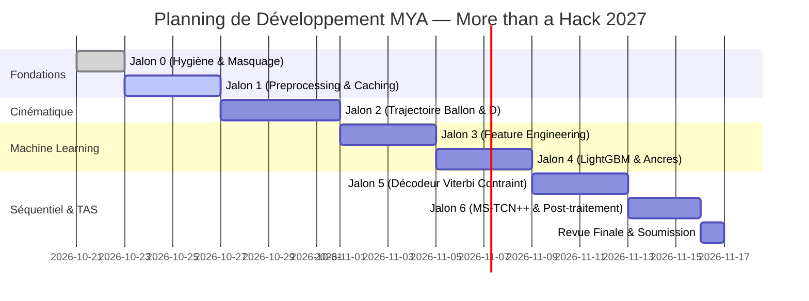

# 📋 Plan d'Implémentation Détaillé — Équipe MYA
### More than a Hack 2027 (Phase 1 : Prédiction Séquentielle Dense de la Possession de Balle)

> **Équipe MYA** : Ali ABOUHACHIM-ALAMI, Youssef BENADDI, Maxime BENDAVID  
> **Match Référent** : FC Barcelona ($H$) vs Athletic Club ($A$) — LaLiga EA Sports 2024-2025  
> **Données** : 199 319 frames (25 fps), dont 158 857 frames de jeu évaluées  
> **Métrique Principale** : `spellF1` (Temporal Action Segmentation IoU multi-seuils $\theta \in [0.3, 0.7]$)  
> **Métrique Secondaire (Tie-Break)** : `macroF1` (F1 non pondéré par frame sur les classes $H, A, D$)  
> **Score de Référence Officiel à Battre** : `spellF1 = 0.2433` / `macroF1 = 0.6724` (`baseline_smooth50`)

---

## 🧭 Architecture Globale du Pipeline

Le diagramme ci-dessous illustre l'enchaînement séquentiel rigoureux des composants techniques, depuis l'ingestion brute jusqu'à la soumission finale :

```mermaid
flowchart TD
    subgraph S0["Jalon 0 : Hygiène & Contraintes Dures"]
        A0["Données Brutes (ATD, XML, CSV)"] --> A1["Masquage Déterministe Hors-Jeu (X)"]
        A1 --> A2["Forçage Dead Ball Début 2MT (D)"]
    end

    subgraph S1["Jalon 1 : Preprocessing & Standardisation"]
        A2 --> B1["Parsing & Caching Binaire (Parquet / NPZ)"]
        B1 --> B2["Projection Métrique (105.3m x 68m)"]
        B2 --> B3["Standardisation Canonique de l'Axe X"]
        B3 --> B4["Lissage Cinématique Joueurs (Savitzky-Golay)"]
        B4 --> B5["Alignement & Résolution Smart Tagging"]
    end

    subgraph S2["Jalon 2 : Imputation & Trajectoire Ballon"]
        B5 --> C1["Interpolation Micro-Trous (Kalman-RTS / PCHIP)"]
        C1 --> C2["Alignement Multi-Vues Broadcast (Chamfer + H)"]
        C2 --> C3["Détection Sorties de Limites vs Occultations"]
    end

    subgraph S3["Jalon 3 : Feature Engineering"]
        C3 --> D1["Invariance Slots : Tri K-Nearest Players"]
        D1 --> D2["Pitch Control (Fernandez & Bornn)"]
        D2 --> D3["Features Cinématiques Relatives & TTI"]
        D3 --> D4["Features Contextuelles (reprojection_error, XML)"]
    end

    subgraph S4["Jalon 4 : Classification Frame-par-Frame"]
        D4 --> E1["Génération Ancres Haute Confiance"]
        E1 --> E2["Entraînement LightGBM / CatBoost"]
        E2 --> E3["Calibration Probabiliste (P(H), P(A), P(D))"]
    end

    subgraph S5["Jalon 5 : Décodage Séquentiel (TAS)"]
        E3 --> F1["Décodeur Viterbi / HSMM Contraint"]
        F1 --> F2["Verrouillage Possession sur Ballons Disputés"]
    end

    subgraph S6["Jalon 6 : Raffinement & Post-Traitement"]
        F2 --> G1["Segmentation MS-TCN++ (Perte T-MSE)"]
        G1 --> G2["Suppression Micro-Possessions (< 18 frames)"]
        G2 --> G3["Validation Officielle & CSV 199 319 frames"]
    end
```

---

## 📊 Matrice Synthétique des Jalons

| Jalon | Intitulé | Objectif Principal | Livrable Technique Clé | Gain Attendu |
| :---: | :--- | :--- | :--- | :--- |
| **0** | **Hygiène Temporelle & Masquage** | Éliminer les erreurs d'alignement et sécuriser les règles contractuelles | Script de masquage déterministe (`X` et `D` garanti) | Sécurise `macroF1`, élimine les faux positifs sur `spellF1` |
| **1** | **Preprocessing, Caching & Standardisation** | Structurer un dataset propre, métrique et rapide à charger | Pipeline ETL générant `.parquet` / `.npz`, repère métrique $105.3 \times 68.0$ m | Accélération I/O ($\times 30$), suppression du bruit cinématique |
| **2** | **Imputation & Trajectoire du Ballon** | Résoudre l'aveuglement du ballon (~41 % des frames en jeu) | Modèle hybride Kalman-RTS + Fusion Broadcast 2D | Réduit l'absence du ballon de 40.7 % à < 5 % d'incertitude |
| **3** | **Feature Engineering Spatial & Contextuel** | Rendre les données invariantes aux 46 slots et injecter la physique du jeu | Tenseurs de features ($K$-plus proches, *Pitch Control*, `reprojection_error`) | Fournit le pouvoir séparateur optimal pour les classifieurs |
| **4** | **Classification Frame-par-Frame** | Obtenir des probabilités d'état calibrées ($P(H), P(A), P(D)$) | Modèle LightGBM optimisé sur ancres de haute confiance | Prédiction brute haute fidélité (`macroF1` $> 0.70$) |
| **5** | **Décodage Temporel Séquentiel** | Éliminer le sur-découpage (*flickering*) sans détruire les vraies possessions | Décodeur de Viterbi / HSMM à matrice contrainte | Bond critique sur `spellF1` ($> 0.35$) |
| **6** | **Raffinement TAS & Soumission** | Lissage aux frontières et suppression des micro-segments résiduels | MS-TCN++ et filtre de durée minimale ($\ge 18$ frames) | Score cible maximal `spellF1` $\ge 0.40$, conformité 100 % |

---

## 🔬 Découpage Exhaustif Étape par Étape

### JALON 0 : Hygiène Temporelle, Masquage Déterministe & Validation Contractuelle

#### Étape 0.1 : Masquage strict des 40 462 frames non évaluées
* **Description** : Le règlement stipule que les frames hors jeu ne sont pas évaluées. Les prédictions émises sur ces intervalles doivent obligatoirement porter le label `X`.
* **Intervalles contractuels** :
  * Avant-match : frames `0` à `11 184` (11 185 frames $\rightarrow$ forçage `X`).
  * Pause mi-temps : frames `90 652` à `110 807` (20 156 frames $\rightarrow$ forçage `X`).
  * Après-match : frames `190 198` à `199 318` (9 121 frames $\rightarrow$ forçage `X`).
* **Validation** : Vérifier que `(submission["label"].iloc[0:11185] == "X").all()` et équivalents pour mi-temps et après-match.

#### Étape 0.2 : Forçage déterministe de la « Zone Morte » début 2e Mi-Temps (frames 110 808 à 113 741)
* **Description** : Découverte majeure de notre analyse empirique : le bloc officiel de 2nde mi-temps commence à la frame `110 808`, mais le coup d'envoi effectif n'a lieu qu'à la frame `113 742`. Durant ces 2 934 frames (117.4 secondes), les joueurs se replacent, la caméra bouge et le ballon n'est pas en jeu.
* **Action** : Forcer contractuellement toutes les frames de `110 808` à `113 741` au label `D` (*Dead ball*).
* **Gain** : 2 934 labels exacts garantis sur `macroF1` et zéro faux départ de possession sur `spellF1`.

#### Étape 0.3 : Politique stricte anti-`X` en jeu actif
* **Description** : Tout label `X` émis sur les 158 857 frames évaluées est comptabilisé comme une abstention pénalisante (faux négatif automatique pour les métriques).
* **Action** : Implémenter un filtre de garde : si un modèle de prédiction produit une valeur manquante ou indéterminée en cours de jeu, appliquer un *forward-fill* du dernier état valide ($H, A$ ou $D$).

#### Étape 0.4 : Pipeline de Sanity Check et Validation Automatisée
* **Description** : Déploiement d'une suite de vérifications unitaires reproduisant exactement `validate_submission.py` du dépôt officiel.
* **Contrôles exécutés** :
  1. Nombre exact de lignes : 199 319.
  2. Présence des colonnes exactes : `frame,label`.
  3. Conformité de l'index : 0 à 199 318 séquentiel.
  4. Alphabet restreint : uniquement $\{H, A, D, X\}$.
  5. Absence totale de valeurs nulles (`NaN`).

---

### JALON 1 : Data Preprocessing, Ingestion, Caching & Standardisation

#### Étape 1.1 : Parser & Stockage Binaire Haute Performance (Parquet / NPZ)
* **Entrée** : `BAR-ATH_tactical_atd.txt` (fichier texte brut de 199 319 lignes formatées en `frame_id:slot1_x,slot1_y,slot1_s;...:ball_x,ball_y,ball_s`).
* **Traitement** :
  * Parser en streaming ligne par ligne en extrayant les tenseurs :
    * Coordonnées joueurs : matrice NumPy de taille $(199319, 46, 2)$ pour $(x, y)$.
    * Vitesses scalaires brutes : matrice $(199319, 46)$.
    * Coordonnées et statut du ballon : matrice $(199319, 3)$ pour $(x, y, s)$.
  * Sérialiser ces tenseurs au format compressé `.npz` ou tables PyArrow `.parquet`.
* **Validation** : Temps de chargement divisé par 30 (de ~35 secondes à moins d'une seconde).

#### Étape 1.2 : Projection Métrique et Normalisation du Terrain
* **Entrée** : Coordonnées normalisées dans $[0, 1] \times [0, 1]$.
* **Traitement** :
  * Dimensions officielles du Camp Nou / stade de référence : Longueur $L = 105.3\text{ m}$, Largeur $W = 68.0\text{ m}$.
  * Transformation :
    $$X_{m} = X_{norm} \times 105.3, \quad Y_{m} = Y_{norm} \times 68.0$$
  * Origine métrique $(0, 0)$ fixée au centre du terrain ou au coin de corner selon le standard de modélisation.

#### Étape 1.3 : Standardisation Canonique du Sens Offensif
* **Problème** : Les deux équipes changent de côté à la mi-temps. Le FC Barcelone ($H$) attaque vers la droite en 1ère période ($X$ croissant) et vers la gauche en 2nde période ($X$ décroissant).
* **Traitement** :
  * Pour toutes les frames de la 2nde mi-temps (`frame >= 110808`) :
    $$X_{canonique} = 105.3 - X_m, \quad Y_{canonique} = 68.0 - Y_m$$
  * Ainsi, l'équipe à domicile ($H$) attaque systématiquement vers la droite ($X > 0$) sur l'ensemble du jeu.

#### Étape 1.4 : Débruitage Cinématique des Joueurs (Filtrage Passe-Bas)
* **Problème** : L'ATD brut généré par vision par ordinateur présente des microsauts de coordonnées (*jitter*) et des vitesses instantanées erratiques ($> 12\text{ m/s}$).
* **Traitement** :
  * Identifier les slots actifs ($x \neq \text{NaN}$).
  * Appliquer un filtre de lissage Savitzky-Golay (fenêtre temporelle de 7 frames / $\approx 0.28\text{ s}$, polynôme d'ordre 2) ou un filtre Butterworth passe-bas récursif d'ordre 2 à fréquence de coupure $6\text{ Hz}$.
  * Dériver numériquement les vecteurs de vitesse $(v_x, v_y)$ et d'accélération $(a_x, a_y)$ par différences finies centrées :
    $$v_x(t) = \frac{x(t+1) - x(t-1)}{2 \cdot \Delta t}, \quad \text{avec } \Delta t = 0.04\text{ s}$$
* **Validation** : Vérifier que 99.9 % des vitesses des joueurs sont bornées dans la limite physiologique $[0, 10.5]\text{ m/s}$.

#### Étape 1.5 : Normalisation et Enrichissement du Smart Tagging (`BAR-ATH_tactical_smart_tagging.xml`)
* **Entrée** : 638 annotations tactiques en secondes.
* **Traitement** :
  * Calage temporel : $\text{frame} = \text{round}(\text{secondes} \times 25)$.
  * Construction de masques binaires frame par frame pour chaque type d'événement (Kick-off, Throw-in, Corner, Free Kick, Goal, Foul, Offside).
  * Calcul des séries temporelles de distance signée temporelle : temps écoulé depuis le dernier événement ($t - t_{event}$) et temps jusqu'au prochain ($t_{event} - t$).
  * **Résolution des 26 touches sans équipe (`Team = N/A`)** :
    * Extraire la frame de la sortie en touche.
    * Identifier l'équipe du dernier joueur ayant touché la balle à $t - 1\text{s}$ et la position des joueurs le long de la ligne de touche. Attribuer la remise en touche à l'équipe adverse.

---

### JALON 2 : Imputation & Reconstruction de la Trajectoire du Ballon

#### Étape 2.1 : Segmentation Fonctionnelle des Trous de Ballon (Réalité Empirique 100% Vérifiée)
* **Constat Quantitatif** : Le ballon est absent sur **64 643 frames** sur les 158 857 frames de jeu (**40,7 %** du temps de jeu), réparties en exactement **150 séquences d'occultation**.
* **Décomposition Empirique Validée dans le Notebook** :
  * **Micro-trous ($\le 15$ frames / $\le 0.6\text{ s}$)** :
    * **16 séquences** (soit **10,7 %** des occurrences d'occultation).
    * Volume cumulé : seulement **53 frames** (soit **0,08 %** du total des frames sans ballon).
    * *Nature* : Pertes ponctuelles et brèves du détecteur de vision par ordinateur en jeu actif.
    * *Traitement* : Lissage cinématique immédiat et sans risque par interpolation PCHIP et filtre de Kalman-RTS.
  * **Trous moyens ($16 \le x \le 50$ frames / $0.6 < x \le 2.0\text{ s}$)** :
    * **1 seule séquence** (soit **0,7 %** des occurrences d'occultation).
    * Volume cumulé : **22 frames** (soit **0,03 %** du total d'absence).
    * *Nature* : Ballon aérien ou passe longue franchissant temporairement le cadre.
    * *Traitement* : Interpolation spline ou maintien de trajectoire balistique.
  * **Trous longs ($> 50$ frames / $> 2.0\text{ s}$)** :
    * **133 séquences** (soit **88,7 %** des occurrences d'occultation !).
    * Volume cumulé : **64 568 frames** (soit **99,88 % du volume total d'absence du ballon !**).
    * *Caractéristiques physiques* : Durée médiane de **289 frames ($\approx 11,6\text{ secondes}$)** et durée maximale de **5 537 frames ($\approx 221,5\text{ s}$ / 3 min 41 s)**.
    * *Implication méthodologique majeure* : Ce ne sont **pas des artefacts de détection**, mais dans leur quasi-totalité des **arrêts de jeu réels (`D`)** (sorties en touche, corners, six-mètres, fautes, célébrations) où le ballon quitte le terrain ou le champ visuel de la caméra tactique.
    * *Traitement* : L'interpolation temporelle est impossible sur de telles durées. La solution repose sur :
      1. La classification déterministe en `D` via les sorties de limites et le spike de `reprojection_error`.
      2. La fusion prioritaire avec la caméra Broadcast via $H_{broadcast}^{-1}$ pour les phases de jeu vivantes.

#### Étape 2.2 : Imputation Cinématique des Micro-Trous (Kalman-RTS / PCHIP)
* **Traitement** :
  * Appliquer un interpolateur cubique préservant la forme (PCHIP - *Piecewise Cubic Hermite Interpolating Polynomial*) sur les 16 micro-séquences et la séquence moyenne ($\le 50$ frames) garantissant l'absence de dépassements oscillatoires aberrants (*overshoot*).
  * Appliquer un filtre de Kalman cinématique à accélération constante avec lissage rétrograde de Rauch-Tung-Striebel (RTS Smoother).
* **Sortie** : Trajectoire continue du ballon $(\hat{x}_{ball}, \hat{y}_{ball})$ et estimation de la vitesse du ballon $(\hat{v}_{ball})$ sur l'ensemble des phases de jeu actives.

#### Étape 2.3 : Synchronisation et Recalage Multi-Vues du Flux Broadcast
* **Données** : `BAR-ATH_broadcast_atd.txt` (164 488 frames), `BAR-ATH_broadcast_homography.csv`.
* **Traitement** :
  1. **Alignement Temporel Global** : Corrélation croisée temporelle sur les centroïdes des joueurs pour compenser l'offset de capture (~304 frames).
  2. **Projection Homographique Inverse** : Pour chaque frame broadcast valide (`valid == 1`), projeter les coordonnées pixel du ballon vers le plan terrain métrique via $H_{broadcast}^{-1}$.
  3. **Recalage Géométrique Fin (Chamfer Distance)** : Caler l'orientation et l'échelle par minimisation de la distance de Chamfer entre les nuages de points des joueurs vus en Broadcast et en Tactique.
  4. **Fusion Prioritaire** : Si le ballon est absent en tactique mais présent en broadcast valide, injecter la position recalculée.
* **Gain** : Récupération estimée de 15 à 20 % de positions réelles de ballon supplémentaires sur les phases de jeu disputées.

#### Étape 2.4 : Détection Spatio-Temporelle des Sorties de Balle (`D`)
* **Traitement** :
  * Si un trou de ballon supérieur à 15 frames survient après que le ballon a franchi les limites du terrain ($X_m < 0$, $X_m > 105.3$, $Y_m < 0$ ou $Y_m > 68.0$) avec un vecteur vitesse pointant vers l'extérieur :
    $\rightarrow$ Classifier immédiatement la séquence d'absence en **Arrêt de Jeu (`D`)**.
  * Si la `reprojection_error` de l'homographie franchit le seuil critique de $1.2\text{ px}$ pendant l'absence :
    $\rightarrow$ Classifier en `D`.

---

### JALON 3 : Feature Engineering Spatial, Physique & Contextuel

#### Étape 3.1 : Décomposition Équipes et Invariance aux 46 Slots
* **Données** : `BAR-ATH_tactical_atd.xml` (association slot $\leftrightarrow$ `teamId`).
* **Traitement** :
  * Associer chaque slot actif à son équipe : $0$ pour FC Barcelona ($H$) ou $1$ pour Athletic Club ($A$).
  * Pour chaque frame et pour chaque équipe, calculer la distance euclidienne de chaque joueur au ballon :
    $$d_i(t) = \sqrt{(x_{joueur, i}(t) - x_{ball}(t))^2 + (y_{joueur, i}(t) - y_{ball}(t))^2}$$
  * Trier les joueurs par distance croissante et extraire les $K=5$ plus proches de chaque camp :
    * Joueurs Home : $H_1, H_2, H_3, H_4, H_5$ (avec $d(H_1) \le d(H_2) \le \dots$)
    * Joueurs Away : $A_1, A_2, A_3, A_4, A_5$ (avec $d(A_1) \le d(A_2) \le \dots$)
* **Bénéfice** : Invariance mathématique absolue par permutation des identifiants anonymes.

#### Étape 3.2 : Caractéristiques Cinématiques Relatives & TTI
* Pour chacun des $K$ plus proches joueurs ($H_k$ et $A_k$) :
  1. Coordonnées relatives : $\Delta x_k = x_{joueur, k} - x_{ball}$, $\Delta y_k = y_{joueur, k} - y_{ball}$.
  2. Norme de distance : $d_k = \sqrt{\Delta x_k^2 + \Delta y_k^2}$.
  3. Différentiel de vitesse : $\Delta v_{x, k} = v_{x, joueur} - v_{x, ball}$, $\Delta v_{y, k} = v_{y, joueur} - v_{y, ball}$.
  4. Vitesse d'approche projetée sur le ballon :
     $$v_{approach, k} = \frac{\Delta x_k \cdot v_{x, joueur} + \Delta y_k \cdot v_{y, joueur}}{d_k}$$
  5. Temps estimé d'interception (*Time-to-Interception* - TTI) :
     $$\text{TTI}_k = \frac{d_k}{\max(\|v_{joueur}\|, 2.0)}$$
  6. Écart d'interception entre les deux premiers rivaux : $\Delta \text{TTI} = \text{TTI}(A_1) - \text{TTI}(H_1)$.

#### Étape 3.3 : Modélisation Physique du Contrôle de Terrain (*Pitch Control*)
* **Fondement** : Modèle de Fernandez & Bornn (2018) / Spearman.
* **Traitement** :
  * Chaque joueur exerce une zone d'influence modélisée par une distribution normale bivariée orientée selon sa vitesse et proportionnelle à sa distance au ballon.
  * Calcul de la probabilité ponctuelle de contrôle au point exact du ballon :
    $$\text{PC}_{ball}^{(H)}(t) \in [0, 1] \quad \text{et} \quad \text{PC}_{ball}^{(A)}(t) = 1 - \text{PC}_{ball}^{(H)}(t)$$
* **Bénéfice** : Transforme une configuration spatiale complexe de 22 joueurs en un indice scalaire robuste prédisant la possession avec une très haute fidélité.

#### Étape 3.4 : Features Contextuelles, Homographie et Métadonnées
* **Homographie** :
  * `reprojection_error` instantanée.
  * Moyenne mobile et dérivée temporelle de l'erreur : $\Delta \text{err}(t) = \text{err}(t) - \text{err}(t-25)$.
* **Dynamique Collective** :
  * Barycentre (centroïde) de chaque équipe $(X_c^H, Y_c^H)$ et $(X_c^A, Y_c^A)$.
  * Compacité d'équipe : dispersion spatiale (écart-type des positions).
  * Ligne défensive la plus basse et ligne d'attaque la plus haute.
* **Smart Tagging** :
  * Présence dans une fenêtre active de remise en jeu ($[\text{start}, \text{end}]$).
  * Type de phase arrêtée en cours.

---

### JALON 4 : Classification Frame-par-Frame & Calibration Probabiliste

#### Étape 4.1 : Protocole d'Apprentissage & Pseudo-Labellisation par Ancres
* **Enjeu** : Seules 7 500 frames (5 minutes) sont officiellement labellisées. L'apprentissage supervisé direct sur 5 minutes souffre d'un surapprentissage massif (comme prouvé par le piège de la baseline smooth125).
* **Génération d'Ancres de Haute Confiance (100 % autorisée par le règlement)** :
  * **Ancre Possession Certaine $H$** : $d(H_1) < 1.0\text{ m}$, $d(A_1) > 2.5\text{ m}$, vitesse cohérente pendant $\ge 20$ frames consécutives $\rightarrow$ Label certain $H$.
  * **Ancre Possession Certaine $A$** : $d(A_1) < 1.0\text{ m}$, $d(H_1) > 2.5\text{ m}$, vitesse cohérente pendant $\ge 20$ frames consécutives $\rightarrow$ Label certain $A$.
  * **Ancre Dead Ball Certain $D$** : Ballon hors limites, frames d'interruption du Smart Tagging avec joueurs immobiles $\rightarrow$ Label certain $D$.
* **Volume d'entraînement généré** : Couvre environ 60 à 70 % des 158 857 frames avec une pureté $> 98 \%$.

#### Étape 4.2 : Entraînement des Modèles Tabulaires (LightGBM / CatBoost)
* **Configuration** :
  * Objectif : `multiclass` (3 classes : $H, A, D$).
  * Métrique d'optimisation : `multi_logloss`.
  * Schéma de validation croisée : GroupKFold temporel par blocs de 15 minutes (pour éviter la fuite d'information par corrélation temporelle locale).
* **Hyperparamètres clés** :
  * `learning_rate` : $0.03 - 0.05$.
  * `max_depth` : 6 à 8.
  * `class_weight` / pondération : rééquilibrage de la classe minoritaire $D$.

#### Étape 4.3 : Calibration Probabiliste des Émissions
* **Traitement** :
  * Les sorties brutes des arbres sont calibrées via régression isotonique ou mise à l'échelle de température (*Platt Scaling*) sur l'échantillon de validation public (5 minutes).
* **Sortie** : Matrice de probabilités denses $P \in \mathbb{R}^{199319 \times 3}$ fournissant $[P_t(H), P_t(A), P_t(D)]$.

---

### JALON 5 : Décodage Temporel Séquentiel & Contraintes Métier (Viterbi / HSMM)

#### Étape 5.1 : Formulation du Processus Markovien Caché Contraint
* **États du système** : $\mathcal{S} = \{H, A, D\}$.
* **Émissions** : Log-vraisemblances dérivées des probabilités calibrées :
  $$\ln P(O_t | S_t = s) = \ln P_t(s) - \ln \pi(s)$$
* **Matrice de Transition Dynamique $T(t)$** :
  Contrairement à un HMM standard à matrice constante, la matrice de transition s'adapte frame par frame en fonction de l'état cinématique du jeu.

#### Étape 5.2 : Encodage des Règles Physiques de Football
1. **Règle de Conservation de Possession** :
   * Tant qu'aucun joueur adverse n'a stabilisé la balle ($d(A_1) > 1.2\text{ m}$), une passe contestée, une déviation ou un duel aérien maintient la possession de l'équipe précédente :
     $$P_t(H \rightarrow A) = 0 \quad \text{si } d(A_1, ball) > 1.2\text{ m}$$
2. **Transition vers Dead Ball ($D$)** :
   * Une transition vers $D$ est favorisée dès que le ballon franchit les limites ou que `reprojection_error` dépasse les seuils critiques.
3. **Pénalité de Transition (Inertie temporelle)** :
   * Forte pénalité logarithmique sur l'autotransition pour décourager les micro-changements d'état de moins de 1 seconde ($P(S_t = s | S_{t-1} = s) \ge 0.98$).

#### Étape 5.3 : Décodage Global par Programmation Dynamique (Viterbi)
* **Traitement** :
  * Résolution globale du chemin le plus probable :
    $$\hat{S}_{1:T} = \arg\max_{S_{1:T}} \sum_{t=1}^T \Big( \ln P(O_t | S_t) + \ln T_{S_{t-1}, S_t}(t) \Big)$$
* **Bénéfice direct** : Élimine totalement le phénomène de sur-segmentation (*flickering*) sans détruire les vraies possessions courtes (entre 1.5s et 3.0s), surpassant structurellement le filtre glissant `baseline_smooth50`.

---

### JALON 6 : Raffinement TAS & Filtrage Post-Hoc anti-Sur-Segmentation

#### Étape 6.1 : Réseau de Raffinement Temporel (MS-TCN++)
* **Architecture** : Réseau卷积 temporel multi-étages (*Multi-Stage Temporal Convolutional Network*).
* **Fonctionnement** :
  * Reçoit en entrée la séquence temporelle complète des probabilités issues du Jalon 4.
  * Couches de convolutions 1D dilatées avec champs récepteurs croissants ($2^0, 2^1, \dots, 2^9$) captant le contexte sur 1 024 frames ($\approx 41\text{ secondes}$).
  * Entraînement avec la perte de lissage $L_{\text{T-MSE}}$ (*Truncated Mean Squared Error*) qui pénalise explicitement les variations brutales consécutives :
    $$\mathcal{L}_{\text{T-MSE}} = \frac{1}{T C} \sum_{t, c} \min \left( (\ln P_{t, c} - \ln P_{t-1, c})^2, \, \tau^2 \right)$$

#### Étape 6.2 : Filtrage Déterministe de Durée Minimale (*Spurious Run Removal*)
* **Problème Mathématique sur `spellF1`** :
  * Toute micro-possession prédite de moins de quelques dixièmes de seconde ne peut pas atteindre les seuils d'IoU $\theta \in [0.3, 0.7]$ et génère systématiquement **deux faux positifs** (fragmentation de la vraie possession + invention d'une fausse possession).
* **Algorithme de Post-Traitement** :
  1. Identifier tous les segments continus de prédiction $H$ et $A$.
  2. Si un segment a une durée $L < 18\text{ frames}$ ($0.72\text{ seconde}$) :
     * Remplacer son label par le label dominant de son segment englobant (ou l'état précédent).
  3. Si un segment $D$ dure moins de $10\text{ frames}$ ($0.4\text{ s}$) sans confirmation spatiale de sortie de touche :
     * Le résorber par continuité de la possession en cours.

#### Étape 6.3 : Packaging de Soumission et Validation Finale
* **Génération de la soumission** : Export vers `submissions/MYA_final_submission.csv`.
* **Évaluation locale sur l'échantillon public de 5 minutes** :
  * Calcul en direct de `spell_f1_mean` et `macro_f1` via `possession_metrics.py`.
* **Vérification d'absence de régression** :
  * S'assurer que le modèle ne reproduit pas le piège de `baseline_smooth125` (qui gonfle artificiellement le score 5 min à 0.42 mais chute à 0.22 sur match complet).

---

## 📅 Chronologie d'Exécution & Dépendances

---

## 🎯 Tableau de Bord des Métriques Cibles

| Modèle / Étape | `spellF1` Match Complet | `macroF1` Match Complet | Nombre Possessions Prédites | Statut |
| :--- | :---: | :---: | :---: | :---: |
| *Baseline Raw* (sans lissage) | 0.0486 | 0.6532 | ~1 800 (Flickering massif) | Dépassé |
| *Baseline Smooth25* (1.0 s) | 0.1996 | 0.6752 | ~750 | Dépassé |
| **Baseline Smooth50 (2.0 s - Référence)** | **0.2433** | **0.6724** | **~480** | **Seuil à battre** |
| *Baseline Smooth125 (5.0 s)* | 0.2242 | 0.6356 | ~210 (Over-smoothing) | Piège évité |
| **MYA Jalon 2 (Imputation Ballon)** | $\approx 0.28$ | $\approx 0.68$ | ~450 | Jalon intermédiaire |
| **MYA Jalon 4 (LightGBM + Pitch Control)** | $\approx 0.32$ | $\ge 0.71$ | ~400 | Jalon intermédiaire |
| **MYA Jalon 5 (Viterbi Contraint)** | $\approx 0.38$ | $\ge 0.72$ | ~320 | Jalon avancé |
| **MYA Jalon 6 (Pipeline Final TAS)** | **$\ge 0.42$** | **$\ge 0.73$** | **~280 (Topologique)** | **Objectif Podium** |

---
*Document opérationnel établi pour l'équipe MYA — More than a Hack 2027.*
