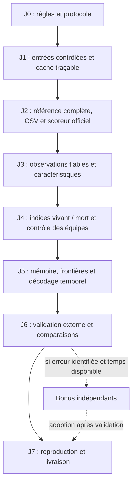

# Plan d'implémentation — équipe MYA

> **Révision : 25 octobre 2026.** Jalons 0, 1 et 2 réalisés et vérifiés le 25 octobre 2026 ; jalons 3 à 7 et bonus à réaliser. Aucun gain de prédiction MYA n’est présenté comme acquis. Il remplace la première feuille de route à partir de l'[analyse de l'implémentation et du benchmark](ANALYSE_IMPLEMENTATION_ET_BENCHMARK.md).
>
> **Équipe :** Ali ABOUHACHIM-ALAMI, Youssef BENADDI, Maxime BENDAVID. **Match :** FC Barcelona (`H`) — Athletic Club (`A`). **Référence de sortie :** vidéo tactique, 199 319 images à 25 images/s. **Classement :** `spellF1` ; départage par `macroF1`. **Échéance annoncée :** 17 novembre 2026 ; vérifier l'heure limite dans le courriel des organisateurs.
>
> Les jalons 0 à 7 constituent le socle à livrer. Les étapes bonus, placées à la fin, sont des expériences indépendantes : aucune n'est une condition pour obtenir une première soumission complète. Pour les jalons 3 et suivants, les noms de modules restent des emplacements prévus. Voir [la validation des jalons 0 et 1](JALONS_0_1_VALIDATION.md) pour les preuves déjà obtenues.

## 1. Objectif et décisions de conception

Construire un programme qui transforme les données automatiques du match en un CSV `frame,label`. Chaque image reçoit `H`, `A`, `D` ou `X`. Une possession correspond au contrôle d'une équipe avec ballon vivant ; une passe ou une déviation ne déclenche pas automatiquement un changement d'équipe.

La première version exploite le tracking tactique et les indications tactiques. Elle doit fonctionner sans vidéo TV, sans reconstruction complète du ballon, sans modèle visuel et sans réseau profond obligatoire. Elle peut conserver des positions manquantes : l'objectif est de déterminer la possession avec une confiance explicite, pas de produire une trajectoire artificiellement complète.

Principes du socle :

- Vérifier les entrées avant toute prédiction et conserver leur provenance.
- Séparer les indices de ballon vivant des indices d'équipe en contrôle.
- Modéliser la continuité et les frontières dès la première version temporelle.
- Utiliser des pénalités souples lorsque les observations sont incertaines.
- Comparer les ajouts séparément, en conservant une version de référence régénérable.
- N'annoncer un bénéfice qu'après mesure ; ne pas viser un nombre de possessions supposé ni un score privé prédit.



## 2. Tableau des jalons indispensables

| Jalon | Livrable | Condition de sortie |
|---|---|---|
| 0 — Réalisé : règles et protocole | Registre des sources et séparation des usages | Données autorisées identifiées ; protocole écrit |
| 1 — Réalisé : ingestion fiable | Données alignées, masques de qualité et caches vérifiés | Tests de format, de source et d'alignement réussis |
| 2 — Réalisé : première chaîne complète | CSV de référence et commande de régénération | Validation officielle et scores publics de référence reproduits |
| 3 — Caractéristiques fiables | Matrice de caractéristiques, conventions et provenance | Invariance et comportement sur données manquantes vérifiés |
| 4 — Vivant / mort et contrôle | Scores d'état issus d'indices explicites | Indisponibilité distinguée d'un arrêt et incertitude conservée |
| 5 — Continuité et frontières | Décodeur temporel simple et réinitialisé par période | Passes, duels, reprises et possessions courtes testés |
| 6 — Comparaisons et robustesse | Registre d'expériences et décision de conservation | Choix justifiés hors des cinq minutes publiques |
| 7 — Livraison | `MYA.csv`, dépôt et document technique | Reproduction exacte depuis une installation propre |

## 3. Jalon 0 — Fixer les règles et le protocole avant les modèles

### Étape 0.1 — Distinguer les usages des sources

Le règlement officiel consulté le 25 octobre fait autorité sur les propositions de l'analyse antérieure :

- Les cinq minutes annotées publiques servent uniquement à vérifier le fonctionnement, l'alignement et le sens des étiquettes. Ne pas les utiliser pour apprendre, calibrer, régler un seuil ou sélectionner une version.
- Les annotations humaines et les corrections manuelles du match fourni sont interdites, y compris sur le tracking ou les seules transitions. Ne pas créer de constantes propres à certaines images à partir d'une inspection humaine.
- Des labels et données externes sur d'autres matchs sont utilisables si leur accès, leurs droits et leur provenance permettent la vérification par les organisateurs. Le socle du plan n'impose aucun jeu externe obligatoire ; la référence ouverte de Metrica Sports est conservée pour mémoire si un besoin exploratoire se présente : https://github.com/metrica-sports/sample-data.
- L'apprentissage sans labels humains et les pseudo-labels produits automatiquement sur les entrées autorisées restent possibles.

Sources : [RULES.md](https://github.com/metrica-sports/more-than-a-hack-2027/blob/main/RULES.md), [FAQ](https://github.com/metrica-sports/more-than-a-hack-2027/blob/main/FAQ.md). En particulier, la calibration sur les cinq minutes proposée dans l'ancien plan est retirée.

### Étape 0.2 — Registre des entrées et des décisions

Pour chaque source, consigner : match, origine, version, droit d'usage, nature automatique ou humaine, usage prévu et emplacement local. Distinguer les labels officiels publics de diagnostic des données autorisées d'apprentissage et de validation externe.

Ne publier aucune donnée privée ni aucun dérivé reconstructible. Vider les sorties détaillées des notebooks avant publication et vérifier les fichiers suivis. Ne pas envoyer les données privées ou leurs extraits à un LLM hébergé. Ces contrôles portent sur des contenus réels du projet ; ils doivent figurer dans la préparation du dépôt public.

### Étape 0.3 — Définir la preuve attendue

Trois niveaux séparés : tests synthétiques de fonctionnement ; diagnostic public du programme ; comparaison de méthodes sur d'autres matchs autorisés. Un score public favorable ne justifie ni le réglage ni l'adoption d'une variante. Un test contre des pseudo-labels ne mesure pas une exactitude indépendante.

**Livrable :** protocole court et registre des sources. **Validation :** aucun apprentissage ou choix de paramètres ne lit les labels publics de BAR-ATH ; aucun label humain externe ne concerne ce même match.

## 4. Jalon 1 — Fiabiliser les entrées et la reproduction

Modules prévus : `src/config.py`, `src/utils/loaders.py`, `src/preprocessing/atd_parser.py`, `cache_manager.py` et `coordinates.py`. Faire utiliser les mêmes interfaces au notebook et à la chaîne finale.

### Étape 1.1 — Chemins et environnement

- Déduire la racine MYA de l'emplacement du package ; permettre un dépôt renommé et un dossier officiel configurable.
- Respecter `MTAH_DATA_DIR` ; éviter les créations de dossiers au simple import.
- Figer une version de Python, les dépendances et la révision du scoreur officiel. Importer son module local, sans dépendre d'un paquet PyPI `possession_metrics` non identifié.
- Séparer les dépendances du socle et celles des bonus.
- Prévoir la correction de `.gitignore` : `/models/` pour les artefacts à la racine, afin de ne pas masquer les nouveaux fichiers de `src/models/`.
- Prévoir des noms de fichiers compatibles Windows pour les documents partagés. Vérifier les fichiers réellement suivis avant chaque commit.

### Étape 1.2 — Décrire chaque source séparément

| Source | Images | Pistes de joueurs | Métadonnées |
|---|---:|---:|---|
| Tactique — socle | 199 319 | 46 | XML tactique |
| TV — bonus | 164 488 | 51 | XML TV |

Lire l'appartenance des pistes aux équipes depuis le XML de la source, sans identifiants d'équipe figés. Ne jamais charger la TV avec les dimensions ou le mapping tactiques. Une piste est un fragment de suivi, pas une identité permanente.

### Étape 1.3 — Contrôles qui doivent arrêter le traitement

Contrôler le nombre exact d'enregistrements, l'unicité et l'ordre des identifiants, les séparateurs, les dimensions, la correspondance XML–colonnes et les valeurs non finies. Pour l'ATD livré, vérifier `frame_video = frame_id - 1` ; ne pas utiliser les compteurs privés de tracking corrigé.

Un fichier tronqué, une ligne supplémentaire, un identifiant dupliqué ou un décalage ne doit ni devenir silencieusement un `NaN`, ni être caché par du remplissage. Distinguer une absence explicitement livrée d'une erreur de lecture.

Pour l'homographie, contrôler la colonne `frame`, les neuf coefficients, `valid` et les erreurs. Pour le Smart Tagging, normaliser la casse, conserver les champs inconnus et les `N/A`, détecter les bornes incohérentes. Employer une convention documentée d'intervalles `[début, fin[`.

### Étape 1.4 — Cache et provenance

Enregistrer avec le cache : source, chemin résolu, signature des entrées, dimensions, version du parseur et conventions de coordonnées. L'invalider après changement de données ou de parseur ; refuser un cache incomplet. Écrire de manière atomique et vérifier l'équivalence lecture directe / cache.

### Étape 1.5 — Repères et unités

Conserver le repère normalisé d'origine et une version métrique `x_m = 105.3 x`, `y_m = 68 y`, avec l'origine au coin correspondant à `(0, 0)`. Les vitesses scalaires sont distinctes des coordonnées et ne doivent pas être multipliées par les dimensions du terrain. La lecture réelle a révélé une divergence : DATA.md annonce des m/s, le XML déclare kph. Le chargeur conserve la vitesse brute, expose `speed_unit` et `speed_documentation_conflict` ; tout futur seuil physique doit attendre une clarification explicite de cette unité.

L'homographie transforme les positions normalisées du terrain en pixels. Son inverse sert pour une détection en pixels ; ne pas l'appliquer aux positions ATD déjà exprimées sur le terrain. Toute normalisation du sens offensif doit être justifiée par des métadonnées ou un algorithme, et transformer aussi les vecteurs associés.

**Réalisation vérifiée le 25 octobre :** 27 tests synthétiques réussis ; tactique
199 319 × 46 et TV 164 488 × 51 entièrement validées ; égalité lecture directe/cache
pour les deux sources ; notebook exécuté en local avec sorties partagées effacées.
Les erreurs d’homographie négatives livrées sont conservées en brut et marquées
non exploitables, séparément de la validité de la matrice. Aucune vérité terrain
n’est utilisée par la commande de validation d’ingestion. Détails et limites dans
[JALONS_0_1_VALIDATION.md](JALONS_0_1_VALIDATION.md).

**Livrable :** données tactiques validées et masques de qualité. **Tests indispensables :** petit fichier valide, tronqué, trop long, désordonné, doublons, observations manquantes, changement de source, cache périmé ; fixture TV de 51 pistes pour prévenir la régression du chargeur générique. Ces fixtures sont synthétiques.

## 5. Jalon 2 — Obtenir très tôt une première soumission complète

Modules réalisés : `src/pipeline.py`, `src/baseline.py`, `src/hygiene/masking.py`, `validator.py`, `src/refinement/exporter.py` ; diagnostic séparé dans `src/diagnostics.py`. Ce jalon précède les modèles avancés.

**Vérifié le 25 octobre :** CSV de 199 319 lignes accepté officiellement ; deux exécutions identiques octet par octet ; quatre scores de référence reproduits ; calcul sans masques MYA identique aux quatre CSV officiels ; 50 tests synthétiques réussis au total. Fenêtre ±50 fixée avant le diagnostic, sans entraînement ni sélection sur les labels publics. Voir [JALON_2_VALIDATION.md](JALON_2_VALIDATION.md).

### Étape 2.1 — Reproduire la référence officielle

Exécuter le scoreur officiel sur les quatre CSV fournis. Conserver ses sorties avec la révision utilisée. Implémenter ensuite une référence tactique complète reproduisant le principe du joueur le plus proche et son lissage, sans en sélectionner la fenêtre sur les labels publics.

| Référence fournie | `spellF1` public | `macroF1` public |
|---|---:|---:|
| raw | 0,0378 | 0,5972 |
| smooth25 | 0,2868 | 0,6200 |
| smooth50 | 0,3256 | 0,6207 |
| smooth125 | 0,4242 | 0,5812 |

La référence privée publiée à battre est `smooth50`, avec `spellF1 = 0,2433`. Ces chiffres décrivent les références, pas des objectifs MYA garantis. Le module officiel fait foi ; ne pas réécrire l'appariement en suivant la description erronée « algorithme hongrois » de l'ancien rapport.

Source : [évaluation officielle](https://github.com/metrica-sports/more-than-a-hack-2027/blob/main/EVALUATION.md).

### Étape 2.2 — Appliquer seulement les informations temporelles officiellement publiées

Convention interne : intervalles demi-ouverts en indices vidéo.

| Intervalle | Traitement |
|---|---|
| `[0, 11185[` | `X` par convention de sortie |
| `[11185, 90652[` | Première période évaluée |
| `[90652, 110808[` | `X` par convention de sortie |
| `[110808, 190198[` | Deuxième période évaluée |
| `[190198, 199319[` | `X` par convention de sortie |
| `[110808, 113742[` | `D`, information publiée dans la FAQ |

Les images non évaluées sont ignorées par le scoreur ; `X` y est une convention pratique, pas une obligation gagnant des points. Les constantes de ce tableau proviennent des documents officiels et doivent garder cette provenance. Aucune autre correction d'image spécifique ne doit provenir d'un visionnage humain.

### Étape 2.3 — Export et abstention

Produire exactement les colonnes `frame,label`, 199 319 lignes de données, indices de 0 à 199318, sans cellule vide. `X` représente une abstention volontaire, pas une erreur de chargement.

Documenter son coût : erreur pour `macroF1` sur les images évaluées ; remplissage au sein des blocs de référence pour la métrique temporelle. Un maintien explicite peut être choisi, mais il ne garantit pas une hausse de `macroF1`. Empêcher toute propagation entre les deux périodes et définir le traitement du début de chaque période.

**Livrable :** une commande régénérant un premier CSV accepté par `evaluation/validate_submission.py`. Deux exécutions de référence doivent produire les mêmes octets. Le code de validation fourni reste l'autorité.

## 6. Jalon 3 — Construire des caractéristiques fiables et des indices d'incertitude

Modules prévus : `src/preprocessing/player_denoising.py`, `smart_tagging.py`, `src/features/team_assignment.py`, `k_nearest.py`, `relative_kinematics.py`, `collective_dynamics.py`, `context_features.py`, `builder.py`.

### Étape 3.1 — Mesurer les trous sans les interpréter comme des arrêts

Recalculer les absences séparément par période et sur la chronologie originale. Ne pas concaténer les mi-temps avant de compter les segments. Conserver leur longueur, l'âge de la dernière observation et la distance jusqu'à la prochaine, puisque l'analyse est hors ligne.

Les comptes détaillés du premier notebook restent des observations à reproduire, pas une vérité sur la nature des phases. Un trou long ne prouve pas `D`. Présenter toute la distribution, y compris les plus longs trous.

### Étape 3.2 — Cinématique par fragments continus

Détecter les ruptures, changements brusques et pistes possiblement dupliquées. Lisser et dériver seulement à l'intérieur de fragments fiables ; ne pas interpoler un joueur à travers une rupture d'identité ou la mi-temps. Conserver un masque de validité et le nombre de joueurs fiables de chaque équipe.

Les limites physiologiques servent d'alertes de qualité, pas de preuve qu'un filtre est bon parce qu'il a écrêté toutes les vitesses. Comparer les dérivées aux vitesses fournies et documenter les écarts.

### Étape 3.3 — Représentation d'équipe indépendante de l'ordre des pistes

Construire au minimum : distances au ballon des joueurs les plus proches de chaque équipe, écart de proximité H–A, nombre de joueurs proches, activité collective et contrastes entre contexte passé et futur. Gérer les cas sans ballon ou avec trop peu de joueurs par des masques explicites.

Pour `Δr = position_joueur - position_ballon`, une vitesse de fermeture positive peut s'écrire `-Δr · (v_joueur - v_ballon) / max(||Δr||, ε)`, uniquement si les vitesses sont fiables. Le ratio distance / vitesse est un indicateur grossier ; ne pas le présenter comme un temps d'interception physique exact.

Tester l'invariance aux permutations au sein des équipes. Ne pas calculer une vitesse en suivant la même place dans un tri par distance : cette place peut changer de joueur à chaque image.

### Étape 3.4 — Smart Tagging comme indice contextualisé

Encoder les phases offensives pour l'équipe indiquée et les phases défensives avec une polarité opposée. Conserver l'incertitude des bornes et les contradictions entre tags. Encoder les proximités des reprises et leur type ; ne pas supposer qu'une fenêtre de corner est entièrement morte ou entièrement vivante.

Garder les touches `Team = N/A` comme inconnues tant qu'une règle générale et vérifiable n'apporte pas d'indice suffisant. Ne pas attribuer automatiquement la touche à l'adversaire du joueur le plus proche une seconde auparavant.

### Étape 3.5 — Qualité des capteurs

Conserver visibilité, longueur des trous, continuité des pistes, effectif fiable, présence de doublons et désaccords des indices. `reprojection_error` est un indice de confiance géométrique ; aucun seuil isolé ne doit forcer `D`.

**Livrable :** matrice de caractéristiques avec noms, unités, masques et provenance. **Validation :** permutations, cas sans ballon, joueur absent, doublon, rupture de piste, frontière de période et calcul passé/futur sur fixtures synthétiques. Réutiliser ces fonctions dans le notebook pour éviter deux implémentations divergentes.

## 7. Jalon 4 — Séparer ballon vivant et contrôle de l'équipe

Modules prévus : `src/imputation/deadball_detector.py`, `src/models/anchors.py`, `dataset.py`, `tabular.py`. Les modèles appris sont conditionnés à une supervision autorisée ; la version par règles demeure une solution complète.

### Étape 4.1 — Score de ballon vivant

Combiner plusieurs indices : mouvement récent du ballon, proximité des limites, activité collective, phases tactiques et indices de reprise. Prévoir les contre-exemples « ballon absent pendant le jeu » et « ballon visible pendant un arrêt ». L'homographie et le ralentissement des joueurs sont des indices souples, jamais la décision de l'arbitre.

### Étape 4.2 — Score d'équipe et mémoire du contrôle

Combiner proximité, durée de contact plausible, cinématique fiable et contexte tactique. Une déviation ou le passage de la balle près d'un adversaire ne suffit pas à établir un contrôle. Distinguer la dernière équipe en contrôle de la prochaine équipe pouvant remettre le ballon en jeu : une proximité pendant `D` ne doit pas devenir une possession vivante.

Maintenir des scores pour H et A même si le ballon est absent, à partir du contexte disponible, avec une confiance réduite. Ne pas inventer une coordonnée pour satisfaire l'interface.

### Étape 4.3 — Préparer la comparaison règles / apprentissage léger

Si des labels externes compatibles sont disponibles, comparer un petit modèle tabulaire aux règles, puis comparer une sortie ternaire directe à la factorisation :

```text
P(D) = 1 - P(vivant)
P(H) = P(vivant) × P(H | vivant)
P(A) = P(vivant) × P(A | vivant)
```

Ces probabilités doivent utiliser des conventions et une supervision cohérentes. En l'absence de calibration indépendante, parler de scores et documenter leur échelle. Ne pas imposer une calibration isotonique sur un minuscule échantillon ni une division automatique des scores par des fréquences de classes biaisées.

Pour les pseudo-labels, conserver origine, couverture, conflit et confiance. Ne pas annoncer 98 % de pureté sans mesure indépendante ; ne pas utiliser leur propre accord comme validation. Les situations ambiguës peuvent rester non supervisées.

**Livrable :** scores d'observation H/A/D et indicateurs de confiance, plus une référence sans apprentissage. **Validation :** cohérence des scores et cas synthétiques de contrôle, de ballon mort et d'incertitude ; toute sélection de modèle ou de calibration se fait hors des annotations publiques de BAR-ATH.

## 8. Jalon 5 — Modéliser la continuité et les frontières

Modules prévus : `src/sequential/dynamic_matrix.py`, `viterbi.py`, `src/hygiene/guards.py`. Commencer par une méthode temporelle légère, puis un Viterbi à trois états si son apport est démontrable ; HSMM et réseaux supplémentaires restent en bonus.

### Étape 5.1 — Pénalités souples et réinitialisation

Associer aux scores d'observation une pénalité de changement modulée par le contexte. Avec Viterbi, chercher un chemin maximisant la somme des scores d'état et de transition ; préciser s'il s'agit d'un modèle probabiliste ou d'une énergie discriminante.

Une observation absente ou imprécise ne doit pas interdire irréversiblement une récupération. Éviter les transitions H/A fixées à zéro par un unique rayon de 1,2 m, ainsi que les contraintes non symétriques entre équipes. Réinitialiser la mémoire aux séparations de période.

### Étape 5.2 — Frontières candidates et confirmation rétrospective

Détecter des candidats à partir des changements de proximité, de mouvement, des réapparitions et des indices de reprise. Utiliser le contexte futur pour confirmer un contrôle, puis estimer son début au premier indice crédible, plutôt que retarder systématiquement la décision jusqu'à la confirmation. Tester l'effet sur le type et le décalage des frontières.

### Étape 5.3 — Comparer des hypothèses pendant les trous

Pour un trou long, comparer maintien de la possession, récupération adverse et arrêt, en utilisant les observations avant et après. La longueur du trou réduit la confiance ; elle ne décide pas seule de son état. Autoriser la mise à jour d'une hypothèse au retour du ballon.

### Étape 5.4 — Préserver les vraies possessions courtes

Ne supprimer aucun segment uniquement parce qu'il dure moins de 18 images. Toute correction doit tenir compte du contexte et de la confiance et être comparée au résultat sans correction. Une courte possession peut obtenir une IoU parfaite.

**Livrable :** séquence H/A/D cohérente et diagnostics des transitions. **Tests indispensables :** passe conservée, déviation sans contrôle, récupération adverse, récupération pendant une absence, ballon visible mort, reprise, vraie possession courte, première image d'une période et absence de propagation à travers la mi-temps. Les labels des tests sont entièrement synthétiques ou proviennent d'autres matchs autorisés.

## 9. Jalon 6 — Comparer, valider et décider

### Étape 6.1 — Validation indépendante et banc de robustesse

Aucun jeu de données externe n'est imposé pour la validation du socle. Deux voies d'évaluation hors des cinq minutes publiques sont prévues :

1. **Banc d'épreuves synthétiques et robustesse (Voie principale du socle) :** Évaluer la résistance des modèles par dégradations réalistes sur BAR-ATH (occultations continues du ballon de 1 à 3 secondes, bruit spatial, pertes de pistes) et mesurer la stabilité des frontières de transition autour des ancres structurelles (zone morte officielle `[110808, 113742[`, coups d'envoi, segments Smart Tagging).
2. **Validation externe (Voie optionnelle) :** Si des matchs externes compatibles sont adoptés (ex. https://github.com/metrica-sports/sample-data), définir des partitions strictes sans chevauchement des possessions ou des fenêtres temporelles. Vérifier que la définition des événements permet une conversion rigoureuse vers H/A/D.

Si aucun jeu externe n'est adopté, la validation repose entièrement sur la voie 1 (robustesse synthétique et ancres physiques), garantissant l'indépendance sans fabriquer de pseudo-classement artificiel. Les cinq minutes publiques restent un simple diagnostic technique d'alignement, y compris pour les étapes bonus.

### Étape 6.2 — Comparaisons par ajout isolé

Comparer, sur la validation autorisée : référence ; indices tactiques ; vivant/mort ; mémoire du contrôle ; décodeur ; puis bonus. Examiner les résultats par type de frontière et niveau de qualité des observations, pas seulement une moyenne globale.

Conserver `spellF1` et son détail par seuil d'IoU, `macroF1`, diagnostics de frontières, fragmentation et temps de calcul. Le bootstrap peut illustrer l'incertitude d'échantillonnage ; il n'autorise pas le réglage sur le public et ne corrige pas un biais de domaine.

### Étape 6.3 — Exploration systématique des combinaisons et hyperparamètres (Grid / Random Search par blocs)

Pour dépasser l'analyse composant par composant sans subir d'explosion combinatoire, explorer les interactions entre briques par recherche structurée :

1. **Recherche factorielle par blocs de caractéristiques :** plutôt que de tester $2^N$ combinaisons individuelles, évaluer les combinaisons de familles fonctionnelles (socle géométrique, cinématique relative, dynamique collective, contexte temporel des trous).
2. **Recherche sur les hyperparamètres temporels :** balayer systématiquement les pénalités de transition Viterbi ($H \leftrightarrow A$, passage à $D$), les priors de durée minimale (HSMM) et les demi-largeurs de fenêtres candidates via grille fine ou recherche aléatoire (Random Search / Optuna).
3. **Critère du plateau de stabilité :** rejeter tout pic de performance isolé (hyperparamètre hyper-spécifique instable) ; ne retenir qu'une configuration reposant sur une région large et stable des scores de validation externe.
4. **Cloisonnement strict :** cette exploration s'exécute exclusivement sur les données de validation autorisées, jamais sur les cinq minutes publiques de BAR-ATH.

### Étape 6.4 — Registre reproductible

Pour chaque expérience : identifiant, hypothèse, commit, configuration, révisions des données et du scoreur, source de supervision, graines, coût, résultats de validation externe, décision et empreinte du CSV. Stocker séparément le diagnostic public et la justification du choix.

Les distributions prédites du match entier servent à détecter des anomalies. Elles ne doivent pas être ajustées pour atteindre les nombres de possessions imaginés dans l'ancien plan. Supprimer les mentions « dépassé », « podium », les puretés garanties et les scores privés projetés tant qu'ils ne sont pas établis.

**Livrable :** une version candidate gelée et une justification des composants conservés ou abandonnés. **Condition d'adoption d'un bonus :** signal favorable sur validation indépendante autorisée, robustesse, coût acceptable et reproduction préservée. Une amélioration du seul score public ne satisfait pas cette condition.

## 10. Jalon 7 — Préparer la livraison sans attendre les bonus

### Étape 7.1 — Reproduction propre

Sur une nouvelle installation, reconstruire le CSV depuis les seules entrées autorisées avec une commande documentée. Vérifier son empreinte, y compris pour les caches reconstruits. Figer graines, dépendances et options nécessaires ; documenter le matériel et les limites éventuelles de déterminisme.

Préserver un chemin d'exécution CPU pour la référence. Le socle ne dépend pas d'un entraînement vidéo lourd ; chaque bonus doit annoncer son coût réel et pouvoir être désactivé.

### Étape 7.2 — Vérification des livrables

- `submissions/MYA.csv` : fichier final, format vérifié par le validateur officiel sur ses octets exacts.
- Dépôt public : sources, configuration finale, dépendances, accès aux poids utilisés et instructions ; aucune donnée privée ni sortie reconstructible.
- `MYA.md` ou `MYA.pdf` : méthode, sources d'entraînement, conventions, gestion des absences, limites, composants essayés et reproduction.

Référence : [SUBMISSION.md](https://github.com/metrica-sports/more-than-a-hack-2027/blob/main/SUBMISSION.md). Le formulaire et l'heure limite doivent être vérifiés dans les messages officiels.

### Étape 7.3 — Marge avant l'échéance

| Période indicative | Priorité |
|---|---|
| 25–28 octobre | Jalons 0–2 : entrées fiables et première soumission complète |
| 29 octobre–4 novembre | Jalons 3–5 ; préparation de la validation externe en parallèle |
| 5–10 novembre | Jalon 6 et au plus un ou deux bonus motivés par les erreurs |
| 11–14 novembre | Gel de la candidate, reproduction propre et document technique |
| 15–16 novembre | Validation des livrables et envoi avec marge |

Ces dates sont une proposition de travail, pas un état d'avancement constaté. La validation et la documentation commencent dès le socle ; elles ne sont pas reportées au dernier jour.

Répartition possible : une personne sur ingestion/reproduction ; une sur les indices de jeu et le décodage ; une sur la validation externe, les expériences et la documentation. Convenir des formats échangés avant de paralléliser.

## 11. Sources et règles de priorité

Les règles et le scoreur officiels priment sur ce plan et sur l'analyse historique : [défi](https://github.com/metrica-sports/more-than-a-hack-2027/blob/main/CHALLENGE.md), [données](https://github.com/metrica-sports/more-than-a-hack-2027/blob/main/DATA.md), [règles](https://github.com/metrica-sports/more-than-a-hack-2027/blob/main/RULES.md), [évaluation](https://github.com/metrica-sports/more-than-a-hack-2027/blob/main/EVALUATION.md), [code des métriques](https://github.com/metrica-sports/more-than-a-hack-2027/blob/main/evaluation/possession_metrics.py), [soumission](https://github.com/metrica-sports/more-than-a-hack-2027/blob/main/SUBMISSION.md).

Les étapes ci-dessous sont optionnelles et indépendantes. Elles partent toutes d'une référence fonctionnelle et doivent respecter le protocole du jalon 6. Il n'est pas prévu de les empiler toutes.

## 12. Étapes bonus — améliorations à tester, sans gain présumé

### Bonus B1 — Interpolation courte et pitch control

**Hypothèse :** améliorer la géométrie locale aide sur certaines frontières. **Essais séparés :** interpolation linéaire puis PCHIP/Kalman-RTS sur des trous courts physiquement compatibles ; ajout d'un indicateur simple de contrôle potentiel au ballon. Conserver observations originales, positions imputées et incertitude séparément.

**Risque :** faux contrôle pendant une occultation, vitesse fictive ou aucune information supplémentaire par rapport aux distances. **Conserver seulement si :** des trous masqués sur données externes et la tâche finale montrent un bénéfice, notamment près des transitions. Une meilleure erreur de position seule ne suffit pas. [Fernandez et Bornn, 2018](https://www.lukebornn.com/papers/fernandez_ssac_2018.pdf).

### Bonus B2 — Durées explicites et états internes enrichis

**Hypothèse :** un HSMM ou des états internes de passe/contrôle conservent mieux les possessions. **Essai :** comparer au décodeur simple, avec distributions de durée estimées hors BAR-ATH et retour final vers H/A/D.

**Risque :** imposer des durées qui effacent les récupérations courtes ou multiplier les paramètres. **Conserver seulement si :** gain externe sur les frontières et les possessions courtes, sans correction manuelle. Les états internes supplémentaires ne changent pas l'alphabet de sortie du concours.

### Bonus B3 — Frontières apprises et raffinement temporel

**Hypothèse :** une branche de frontières inspirée d'ASRF, un petit TCN ou MS-TCN++ améliore les intervalles par rapport aux candidats heuristiques. **Essai :** une famille à la fois, supervision externe ou automatique tracée, séquences et masques explicites ; éviter d'empiler plusieurs lissages sans comparaison.

**Risque :** peu de supervision indépendante, frontières étalées ou surajustement. **Conserver seulement si :** les gains externes persistent selon la durée des possessions et la qualité du tracking. [ASRF](https://yiskw713.github.io/asrf/), [MS-TCN++](https://arxiv.org/abs/2006.09220).

### Bonus B4 — Apprendre directement depuis les joueurs et le contexte

**Hypothèse :** un modèle temporel léger peut prédire H/A/D, ou vivant/mort puis équipe, sans reconstruire d'abord chaque position du ballon. **Essai :** encodeur invariant par équipe, contexte temporel court, comparaison aux règles et au modèle tabulaire ; sources de supervision autorisées uniquement.

**Risque :** mémorisation de styles d'équipe ou de pistes, écart entre conventions des données externes et du concours. **Conserver seulement si :** robustesse externe aux absences du ballon et aux permutations/ruptures, et coût justifié. [Borghesi et al., 2023](https://doi.org/10.1016/j.eswa.2023.119780).

### Bonus B5 — PathCRF et apprentissage conjoint de trajectoires/états

**Hypothèse :** les interactions entre joueurs et la cohérence d'un chemin de possession apportent de meilleurs indices pendant les absences. **Essais alternatifs :** examiner le transfert de [PathCRF](https://github.com/hyunsungkim-ds/pathcrf) ou une variante simplifiée par équipe ; étudier [TranSPORTmer](https://arxiv.org/abs/2410.17785) et [BallRadar](https://arxiv.org/abs/2306.08206) si un apprentissage conjoint peut être reproduit.

Vérifier d'abord code, poids, droits, conventions des labels et données nécessaires. PathCRF annonce des modèles et une préparation Sportec accessibles ; cela ne garantit pas leur transfert aux pistes du concours.

**Risque :** l'invariance à l'ordre des joueurs ne traite pas leurs changements d'identité temporelle ; une bonne trajectoire reconstruite n'assure pas une bonne possession. **Conserver seulement si :** l'adaptation aux ruptures est vérifiée et la validation externe justifie la complexité. Ne pas engager les trois familles simultanément.

### Bonus B6 — Tracking et images locales des joueurs

**Hypothèse :** les postures et gestes aident à distinguer contrôle, déviation et remise en jeu. **Essai :** images centrées sur les joueurs via la caméra tactique et sa géométrie, encodeur préentraîné éventuellement figé, fusion avec les caractéristiques du socle ; aucune annotation manuelle du match.

**Risque :** erreurs de cadrage, coût d'extraction et supervision externe insuffisante. **Conserver seulement si :** gain sur les ambiguïtés ciblées et coût d'inférence acceptable. Réutiliser les images ou caractéristiques en cache local avec provenance, sans les publier. [Peral et al., WACV 2026](https://openaccess.thecvf.com/content/WACV2026/papers/Peral_Multi-Modal_Soccer_Scene_Analysis_with_Masked_Pre-Training_WACV_2026_paper.pdf).

### Bonus B7 — Fusion avec la caméra TV

**Hypothèse :** la seconde vue résout des absences importantes pour les transitions. **Essai :** commencer par ses 51 pistes et son XML, puis produire un alignement automatique par segments avec score de confiance et possibilité de rejet. Traiter coupures et ralentis ; une homographie valide n'est pas une preuve de direct.

Ne pas supposer un offset global de 304 images. Comparer les positions ATD dans un repère terrain cohérent ; utiliser l'homographie inverse seulement pour des détections en pixels. Ne fusionner que les correspondances temporelles et géométriques fiables.

**Risque :** une position convaincante issue d'un ralenti peut créer une fausse récupération. **Conserver seulement si :** l'alignement est contrôlé automatiquement et la qualité finale progresse sur validation externe ; aucun pourcentage de positions récupérées n'est garanti.

### Bonus B8 — Détection visuelle ciblée, diffusion et combinaison de spécialistes

Trois essais indépendants, à n'ouvrir qu'en présence d'une erreur persistante :

- **Détection visuelle du ballon :** un détecteur préentraîné sur d'autres matchs, appelé sur des zones ambiguës, avec contrôle de faux positifs et retour à l'incertitude si échec.
- **Segmentation générative :** [DiffAct](https://github.com/Finspire13/DiffAct), si données, supervision et coût rendent une comparaison réaliste. Les résultats sur d'autres domaines ne prédisent pas spellF1 ici.
- **Combinaison de spécialistes :** fusionner des scores avant le décodage si les erreurs des approches sont complémentaires ; ne pas voter naïvement sur des étiquettes qui fragmentent les possessions.

**Règle d'arrêt commune :** abandonner un essai si son gain indépendant reste indémontré, son coût menace la reproduction ou le calendrier, ou ses entrées ne respectent pas les règles. Conserver alors la candidate du socle ; documenter l'essai et la raison de son abandon.
